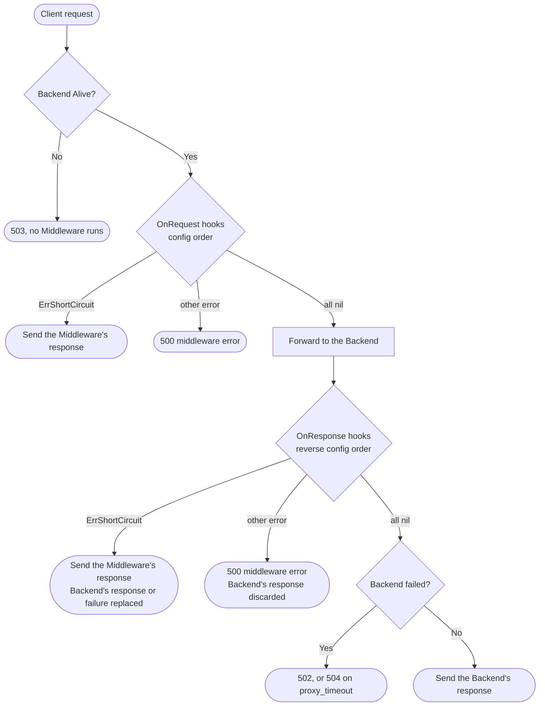

# Middleware

A **Middleware** is a Go snippet, declared in the config file, that runs
before and after divisor proxies a request and may rewrite the request or the
response. Divisor interprets it with [Yaegi](https://github.com/traefik/yaegi)
at startup, so there is nothing to compile or rebuild.

Middleware runs for every request divisor forwards to a Backend, on both the
HTTP/1.1 and the HTTP/2 listener. It does not run for requests divisor answers
before a Backend is picked: the `503` when no Backend is Alive, the `413` for a
body over `server.max_request_body_size`, or a malformed request.

The chain walked through on this page is a complete, tested config:
[`examples/middleware-chain.config.yaml`](../examples/middleware-chain.config.yaml).

## Writing a Middleware

A Middleware is one Go file with:

- any package name;
- a constructor with exactly this signature:
  `func New(config map[string]any) middleware.Middleware`;
- a type implementing the two hooks of
  [`middleware.Middleware`](../middleware/middleware.go):

  ```go
  type Middleware interface {
      OnRequest(ctx *Context) error
      OnResponse(ctx *Context, err error) error
  }
  ```

It may import the Go standard library and
`github.com/aaydin-tr/divisor/middleware`, nothing else. `fasthttp` itself
cannot be imported, but you do not need it: `middleware.Context` embeds
fasthttp's [`*RequestCtx`](https://pkg.go.dev/github.com/valyala/fasthttp#RequestCtx),
so `ctx.Request`, `ctx.Response` and every `RequestCtx` method
(`ctx.SetStatusCode`, `ctx.SetBodyString`, `ctx.Path`, ...) are there.

This Middleware, from the example chain, gives every request an
`X-Request-Id` unless the client already sent one (`custom_headers`' `$uuid`
would overwrite it):

```go
package middleware

import (
    "strconv"
    "sync/atomic"

    "github.com/aaydin-tr/divisor/middleware"
)

// One instance serves every request concurrently: the counter is atomic.
type RequestID struct {
    prefix string
    issued atomic.Uint64
}

func New(config map[string]any) middleware.Middleware {
    prefix, _ := config["prefix"].(string)
    return &RequestID{prefix: prefix}
}

func (r *RequestID) OnRequest(ctx *middleware.Context) error {
    if len(ctx.Request.Header.Peek("X-Request-Id")) == 0 {
        id := r.prefix + "-" + strconv.FormatUint(r.issued.Add(1), 10)
        ctx.Request.Header.Set("X-Request-Id", id)
    }
    return nil
}

func (r *RequestID) OnResponse(ctx *middleware.Context, err error) error { return nil }
```

To get completion and type checking in your editor, keep the file in a Go
module that requires `github.com/aaydin-tr/divisor`
(`go get github.com/aaydin-tr/divisor/middleware`). Divisor itself needs no
module: the `middleware` package is built in.

To log, use the standard `log` package, which writes to stderr with divisor's
own logs. Never `fmt.Print*`: stdout carries only the
[Access log](observability.md), and a stray line there breaks whatever parses
it.

## Declaring it in the config

Each entry under `middlewares` is one Middleware; the keys are listed in
[Configuration](configuration.md#middlewares).

```yaml
middlewares:
  - name: request-id                    # used in logs and errors
    file: /etc/divisor/middleware/request_id.go
    config:                             # handed to New, free-form
      prefix: divisor
  - name: maintenance
    disabled: true                      # skipped; needs no code or file
```

- `code` holds the source inline; `file` points at a `.go` file instead. Give
  exactly one. A relative `file` is resolved against divisor's working
  directory, not the config file's, so prefer an absolute path.
- `config` reaches `New` as decoded YAML: integers are `int`, other numbers
  `float64`, lists `[]any`, maps `map[string]any`. Use the two-value type
  assertion (`v, ok := config["key"].(int)`) so a missing key does not panic.
- Every Middleware is compiled and its `New` called once, at startup. A
  compile error, a missing or mistyped `New`, or a panic in `New` stops
  divisor at startup with that error.
- A [Reload](configuration.md#reload) never touches Middlewares: an edit to
  `middlewares` is rejected (restart required), and an edit to a `file`
  takes effect at the next restart.

[`examples/middleware.config.yaml`](../examples/middleware.config.yaml) shows
more entries, including `file` Middlewares and a disabled one.

## The hooks

### `OnRequest(ctx)`

Runs before the Backend is asked. The Backend is already picked, and
`ctx.Request` is the request as divisor will forward it: hop-by-hop headers
removed, `Host` set to the Backend's address, the Client IP appended to
`X-Forwarded-For`, `custom_headers` applied. The request body is complete
(`ctx.Request.Body()`): requests are buffered, never streamed. Header names
are normalized, so `ctx.Request.Header.Peek("X-Api-Key")` matches whatever
case the client sent. Whatever you change is what the Backend receives.

### `OnResponse(ctx, err)`

Runs after the attempt to get the Backend's response, whether it succeeded or
not.

- `err == nil`: `ctx.Response` holds the Backend's response, whatever its
  status: a Backend's own `500` is a response, not a failure. The body is
  complete and exactly as the Backend sent it (still compressed if it set
  `Content-Encoding`; `ctx.Response.BodyUncompressed()` decodes it). A
  [Streamed response](#streamed-responses) is the exception.
- `err != nil`: the Backend gave no complete response (refused, reset, timed
  out under `server.proxy_timeout`). `ctx.Response` may still hold whatever
  the Backend sent before failing. If every hook returns `nil`, divisor then
  answers `502 {"message":"bad gateway"}`, or `504 {"message":"gateway timeout"}`
  for a timeout: it sets the status, body and `Content-Type`, and keeps the
  other headers your Middleware added. To answer differently, Short-circuit.

### What a hook returns

| A hook returns | Divisor |
| --- | --- |
| `nil` | continues the chain |
| `middleware.ErrShortCircuit` | sends `ctx.Response` as the Middleware left it; no later hook runs ([Short-circuiting](#short-circuiting)) |
| any other error | discards `ctx.Response`, logs the error, and answers `500 {"message":"internal server error"}`; no later hook runs |
| (panics) | recovers, logs the panic and its stack, and answers `500 {"message":"internal server error"}` |

The error's text goes to divisor's Application log (stderr, `error` level),
never to the client. To send the client a specific status or body, write it
to `ctx.Response` and Short-circuit.
`return nil` never stops the chain, whatever the hook wrote to `ctx.Response`.

## Order

`OnRequest` hooks run in config order. `OnResponse` hooks run in **reverse**
config order: the first Middleware sees the request first and the response
last, after every later one has had its say.

```text
config order:   fallback, api-key, request-id

OnRequest:      fallback -> api-key -> request-id -> Backend
OnResponse:     Backend -> request-id -> api-key -> fallback
```

A hook that stops the chain (Short-circuit or error) skips the hooks that
would run after it:

- from `OnRequest`: the later Middlewares' `OnRequest` **and every
  `OnResponse`**, its own included;
- from `OnResponse`: the `OnResponse` of the Middlewares before it in config
  order.

So `OnResponse` is not guaranteed to follow your `OnRequest`: never pair them
for bookkeeping (open/close counters, a lock taken in one and released in the
other). And place a Middleware by when it must run: the example chain lists
`fallback` first so that its `OnResponse` runs last, and its Short-circuit
skips no other Middleware's `OnResponse`.

## Short-circuiting

A Middleware can answer the request itself: a **Short-circuit**. Write the
response to `ctx.Response` and return `middleware.ErrShortCircuit`. Divisor
sends that response as you left it (any status, `200` included) and runs no
later hook. From `OnRequest` the Backend is never asked; from `OnResponse` the
response replaces the Backend's, or the `502`/`504` divisor would have sent.

The guard from the example chain rejects requests without the right API key,
and strips the key before the Backend sees the request:

```go
func (a *APIKey) OnRequest(ctx *middleware.Context) error {
    sent := ctx.Request.Header.Peek("X-Api-Key")
    if len(a.key) == 0 || subtle.ConstantTimeCompare(sent, a.key) != 1 {
        ctx.SetStatusCode(401)
        ctx.SetContentType("application/json")
        ctx.SetBodyString(`{"message":"missing or wrong api key"}`)
        return middleware.ErrShortCircuit
    }
    ctx.Request.Header.Del("X-Api-Key") // the Backend never sees the key
    return nil
}
```

The fallback replaces a Backend failure with a `503` and a `Retry-After`:

```go
func (f *Fallback) OnResponse(ctx *middleware.Context, err error) error {
    if err == nil {
        return nil
    }
    ctx.Response.Reset() // drop whatever a Backend that failed mid-read left behind
    ctx.SetStatusCode(503)
    ctx.Response.Header.Set("Retry-After", f.retryAfter)
    ctx.SetContentType("application/json")
    ctx.SetBodyString(`{"message":"service temporarily unavailable"}`)
    return middleware.ErrShortCircuit
}
```

- When replacing a response in `OnResponse`, start from
  `ctx.Response.Reset()`: otherwise the Backend's headers (or a failed
  Backend's partial ones) go out with yours.
- The match is `errors.Is`, so a wrapped sentinel
  (`fmt.Errorf("blocked %s: %w", ip, middleware.ErrShortCircuit)`) still
  Short-circuits.
- Hop-by-hop headers (`Connection`, `Keep-Alive`, `Transfer-Encoding`, ...)
  are removed from a Short-circuit response as from any other.
- A Short-circuited request still counts against the picked Backend: its
  request count and sequence number (`$incremental`)
  advance. Its Access log line names that Backend and carries
  `"short_circuit": true`.

Why a sentinel and not a method on `ctx`: the return value alone then decides
what happens (`nil` continues, the sentinel sends your response, any other
error is a `500`), with no flag to check besides it.

## Rules every Middleware must follow

- **One instance serves every request.** `New` runs once per config entry, and
  that single instance handles all requests, to every Backend, concurrently.
  A mutable field on your struct (counter, cache, map) is shared by all of
  them: guard it with `sync/atomic` or a `sync.Mutex`. Keep per-request state
  in the request itself (a header, as `request-id` does), never on the
  struct.
- **Never keep `ctx`.** `ctx` wraps a pooled `fasthttp.RequestCtx` that divisor
  reuses for another client's request as soon as the handler returns. Do not
  store `ctx`, `ctx.Request`, `ctx.Response`, or any `[]byte` read from them
  (`Peek`, `Body()`, ...) past the hook's return, and never use them from a
  goroutine you start: a retained `ctx` reads, or writes into, someone else's
  request. Copy what you need first:

  ```go
  // Wrong: the slice points into a buffer the next request overwrites.
  m.lastAgent = ctx.Request.Header.UserAgent()
  go audit(ctx)

  // Right: copies, safe to keep and to hand to a goroutine.
  agent := string(ctx.Request.Header.UserAgent())
  path := string(ctx.Path())
  go audit(agent, path)
  ```

- **Don't block.** Nothing bounds a hook's own run time: `server.proxy_timeout`
  covers only the Backend. A hook that waits holds its client's request for as
  long as it waits, and the code is interpreted, so keep hooks short.

## Streamed responses

With `server.streaming` on, a Backend response that is an event stream
(`text/event-stream`) or declares no `Content-Length` is a
[Streamed response](configuration.md#streamed-responses): divisor forwards its
body as it arrives. `OnResponse` runs on it once the Backend's status and
headers arrive, before the first body byte is forwarded:

- `ctx.Response` holds the status and headers with an **empty body**. No
  Middleware ever sees a Streamed response's body.
- Status and header changes are forwarded with the stream; a body you set is
  dropped.
- `middleware.ErrShortCircuit` still works: the Backend stream is closed and
  the response you wrote is sent instead. `ctx.Response` still carries the
  Backend's headers (`Content-Type: text/event-stream`, ...), so start from
  `ctx.Response.Reset()`. Any other error is the usual `500`.

Every other response, one that declares a `Content-Length` and is not an
event stream, reaches `OnResponse` whole, as with streaming off, so body
rewrites keep working on it. A Middleware that must rewrite bodies needs its
Backends to declare a length, or streaming off.

## Request lifecycle

1. A Backend is picked. (None Alive: `503`, no Middleware runs.)
2. Divisor prepares the request: hop-by-hop headers removed, `Host`,
   `X-Forwarded-For` and `custom_headers` set.
3. `OnRequest` hooks run in config order. A Short-circuit sends the
   Middleware's response; any other error answers `500`. Either way the
   Backend is never asked and no `OnResponse` runs.
4. The request is forwarded to the Backend; its response, or the failure, is
   captured (a Streamed response at its status and headers).
5. `OnResponse` hooks run in reverse config order with the Backend failure as
   `err` (`nil` on success). A Short-circuit sends the Middleware's response;
   any other error answers `500`.
6. Hop-by-hop headers are removed from the response. If every `OnResponse`
   returned `nil` and the Backend failed, divisor writes its `502`/`504`.
7. The response is sent; a Streamed response's body follows as the Backend
   sends it.


